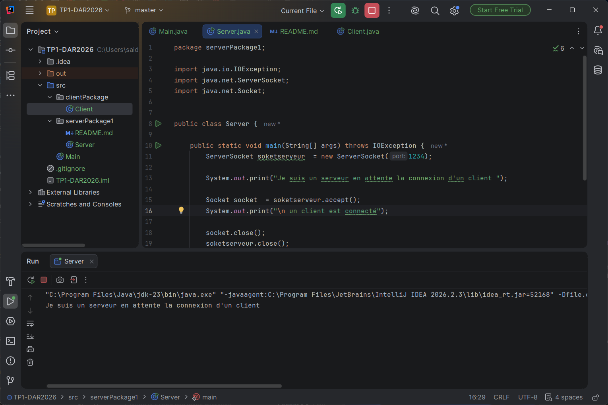
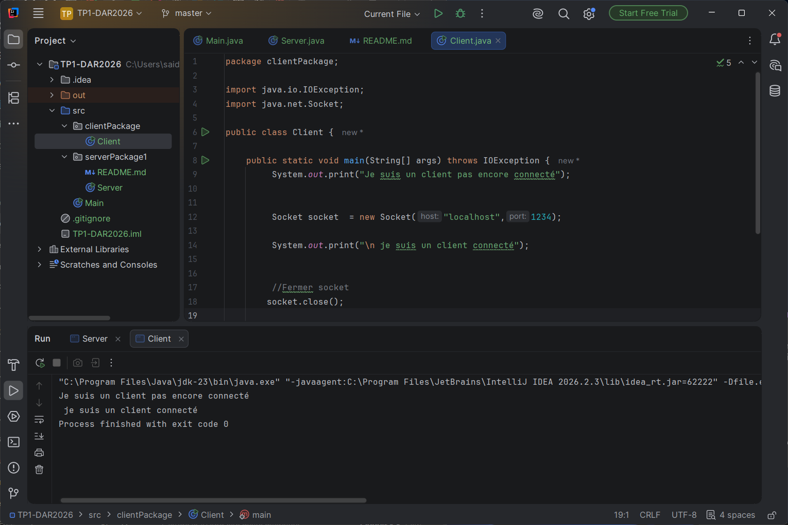
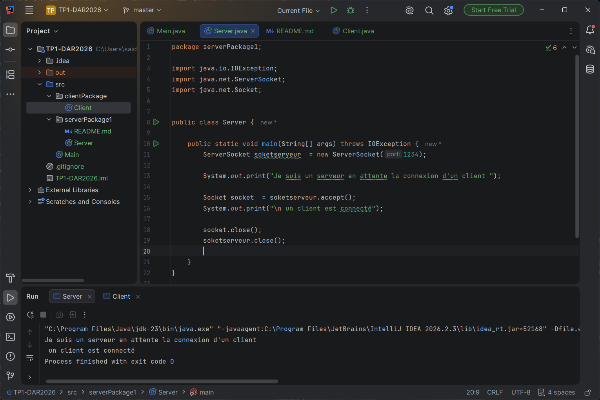
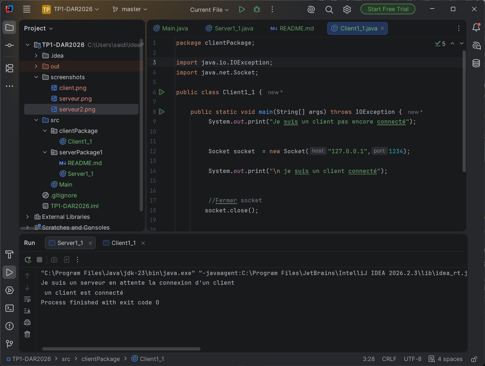

# TP1 activité 1.1 ; connection client serveur

**nom & prenom : saidi nouha**
**class : LSI3 3.2**

## TP 1 ACTIVTE 1
### serveur:

la classe *serveur* se trouve dans le package "serverPackage1"
on a crée une "socketserveur" sur le port 1234
la methode *accept()* pour attendre la connextion d'un client, c'est une methode bloquante. le serveur est en ecoute pour le port 1234.
le serveur affiche un message "Je suis un serveur en attente la connexion d'un client" on attendat la connexion d'un client.
### le client

la classe *Client* se trouve dans le package "clientPackage"
on a crée un objet Socket avec l'adresse du serveur 'localhost' zt le meme port  1234 que le serveur 
en executant le code on afiiche :
"Je suis un client pas encore connecté…" avant la creation du Socket, puis il affiche "je suis un client connecté" une fois la connexion est accepte pa r le serveur 

### le serveur aprés la connexion 
une fois le client est connecté  la méthoode accecpt() se debloque et il affiche " un client est connecté"

###  test apres le Changement du nom du localhost par une adresse IP.
Le meme résultat  `localhost` est un nom qui est traduit en la LOOPBACK `127.0.0.1` : le client
contacte donc la même machine, mais en utilisant directement l'adresse.

on ferme la socket a la fin.

## TP 1 ACTIVTE 2 : Service de calculatrice

